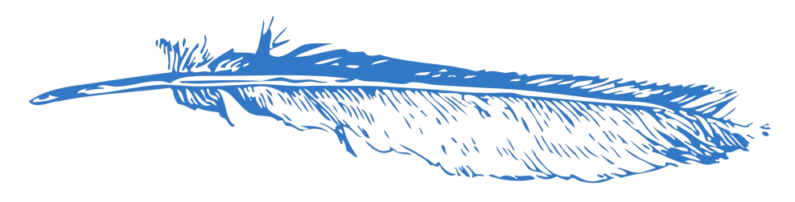

  

 
 

<h1>quillcode</h1>

A terminal-based AI coding agent.

Plan, chat, and build inside your local project with a Bun-powered CLI, Hono API, Drizzle ORM, Clerk auth, and AI SDK streaming.

 

  &nbsp;
  &nbsp;
  &nbsp;
  &nbsp;
  &nbsp;
  &nbsp;
  &nbsp;
  &nbsp;
  &nbsp;
  

 
